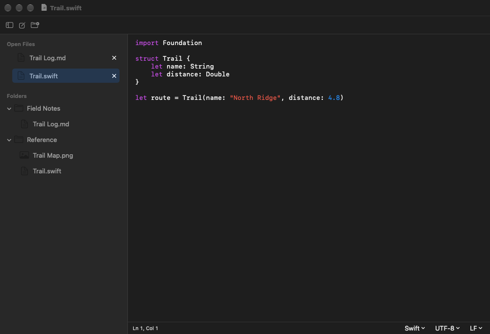
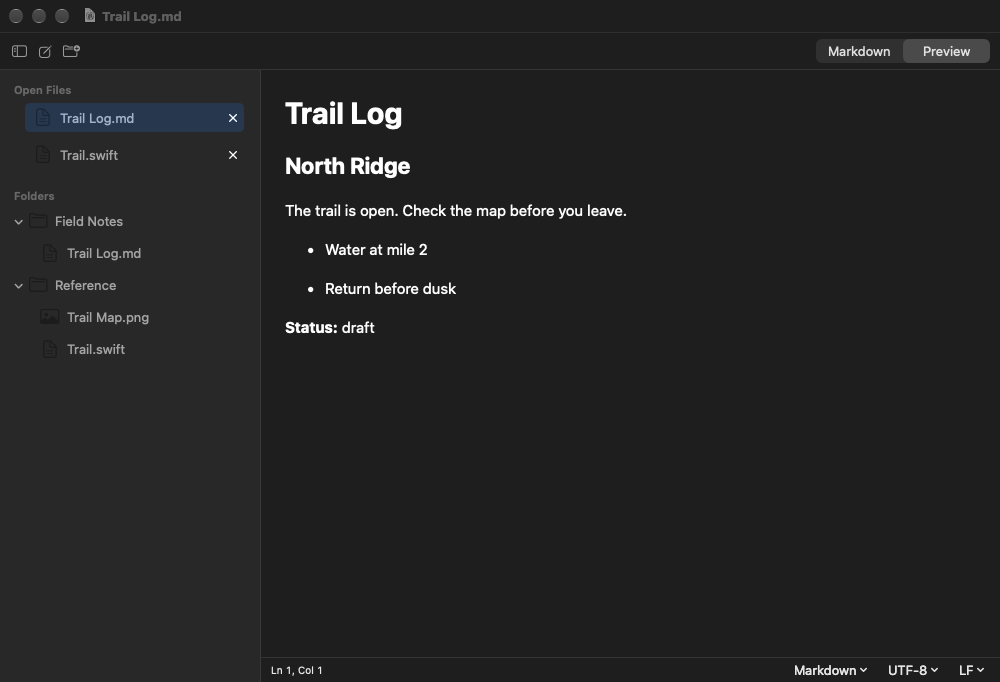
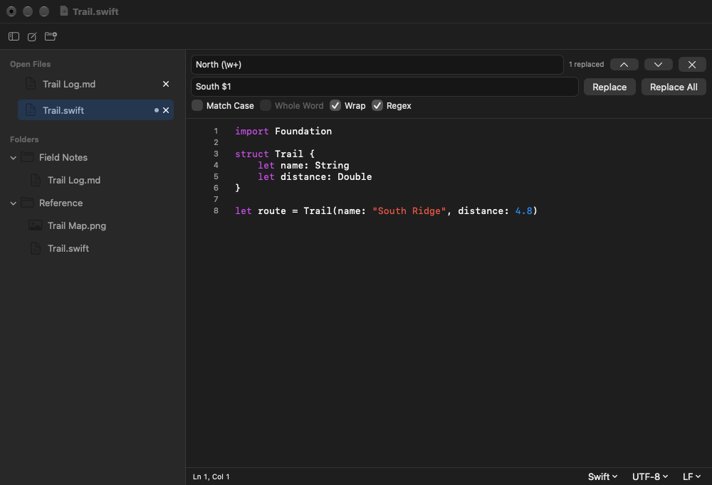
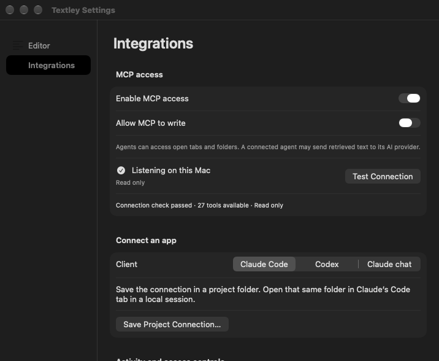

# Textley

Textley is a native Mac editor for code, text, and Markdown. Open your folders, keep files in sidebar tabs, get syntax coloring for seven languages, and preview Markdown before you save. When you want help, Claude Code, Codex, or Claude chat can work in the same files through Textley's local MCP server.

Textley is free for Apple silicon Macs running macOS 14 or later. There's no account and nothing to sign in to.

[Download and install Textley](https://textley.ai/download/) · [textley.ai](https://textley.ai/)



## What it does

- **Folders and tabs.** Open several folders as roots in the left sidebar. Files open as vertical tabs, each with its own edits, undo history, selection, and scroll position. Move a tab into its own window to see two files side by side. Textley watches the folders and keeps the tree current.
- **Syntax coloring.** Swift, JavaScript, TypeScript, JSON, HTML, CSS, and Markdown, detected from the filename with a manual override. Coloring lives in the editor display, so it never changes your file.
- **Markdown preview.** Switch between the source and a rendered preview with **⌥⌘P**. Preview works offline, reflects unsaved changes, and doesn't load remote images.
- **Find and replace.** Case, whole-word, and regex matching with capture groups. Replace All undoes in one step.
- **Clean up text.** Trim trailing whitespace, change case, and sort lines, on the selection or the whole document.
- **File fidelity.** UTF-8 with or without BOM, BOM-marked UTF-16, LF and CRLF are preserved unless you change them. Textley asks before overwriting a file another app changed.
- **Agents on your terms.** In **Settings → Integrations**, turn on **Enable MCP access** to let Claude Code, Codex, or Claude chat list your folders and tabs, read, and search files. Turn on **Allow MCP to write** to let connected agents edit and save with revision checks. The server listens on this Mac only and requires an access token kept in Keychain. See [MCP setup](https://textley.ai/mcp/).
- **Automatic updates.** The release build checks for signed updates with [Sparkle](https://sparkle-project.org/) and installs them automatically. Turn that off in **Settings → Editor → Updates**, or choose **Textley → Check for Updates…**.







## Build and run

Use Xcode 16.3 or newer on an Apple silicon Mac. Open `Package.swift` in Xcode, or build from the repo root:

```sh
swift build
swift test
./Scripts/build-app.sh build debug
open build/Textley.app
```

`build-app.sh` writes an ad-hoc signed `Textley.app` to the output directory you pass (default `build/`). Source builds leave out Sparkle; only the Developer ID release includes the updater.

## Release

Protomota's direct-download release is a Developer ID–signed app with Sparkle in a branded, notarized drag-to-Applications disk image.

```sh
python3 -m venv .venv-dmg && .venv-dmg/bin/pip install -r Packaging/macOS/requirements.txt
TEXTLEY_DMG_PYTHON=.venv-dmg/bin/python \
  ./Scripts/release-app.sh "$RELEASE_DIR" --keychain-profile "$NOTARYTOOL_PROFILE"
```

Raise `CFBundleShortVersionString` and `CFBundleVersion` in `Scripts/Info.plist` for every update and use a fresh release directory. The script builds the app with Sparkle, makes and verifies the installer, signs, notarizes and staples it, and writes the signed `appcast.xml` and `SHA256SUMS`. It signs the feed with the `textley-direct` Sparkle key and checks that it matches the public key in `Scripts/Sparkle.plist`. The private key stays in the macOS Keychain.

To publish, serve the stapled DMG under `https://textley.ai/downloads/` and the feed at `https://textley.ai/appcast.xml`, publishing the DMG before the feed. Changing either file's bytes requires regenerating its signature.

## Project layout

| Path | What's there |
| --- | --- |
| `Sources/TextleyCore` | Text files, encodings, syntax coloring, Markdown rendering, and cleanup commands |
| `Sources/Textley` | The AppKit and SwiftUI app, folder vaults, settings, updates, and the MCP server and STDIO bridge |
| `Resources/TextleyClaudeMCP` | The Claude chat desktop extension that the app exports from Settings |
| `distribution/claude` | The Claude Code plugin package |
| `Scripts`, `Packaging` | App bundle, release, and installer tooling |
| `Tests` | Core, app, and MCP tests |

[Product requirements](PRD.md) · [Support](https://textley.ai/support/) · [Privacy](https://textley.ai/privacy/)

## Source availability

Copyright © 2026 Protomota, LLC. The source is available to inspect. Third-party components, including Sparkle and the Swift MCP SDK, retain their own licenses.
